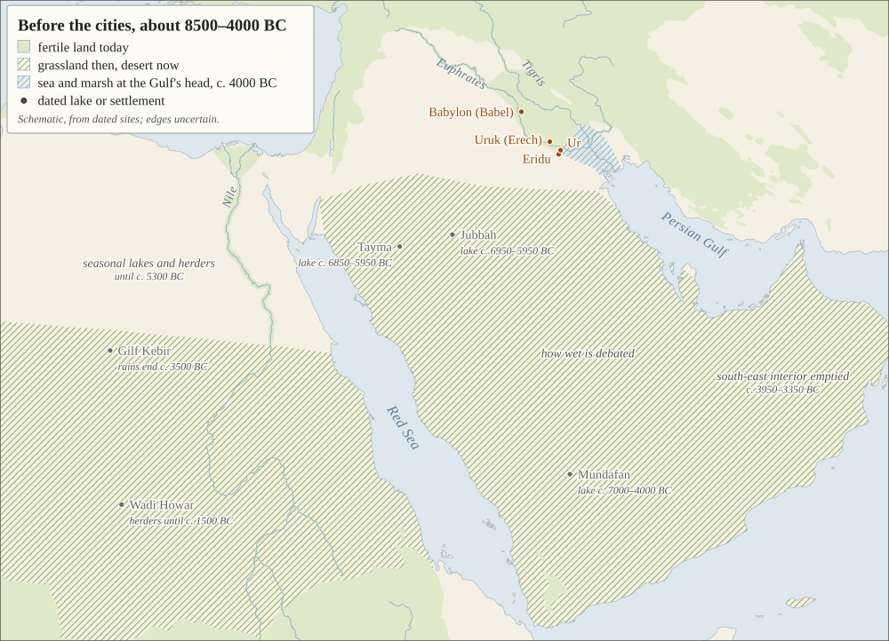
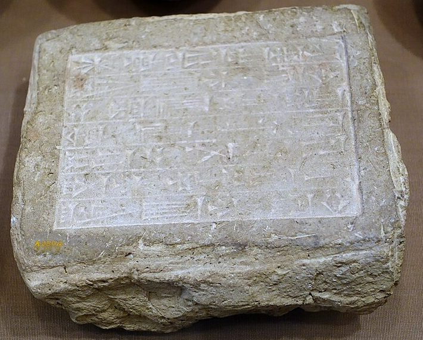

# 11. A Name for Ourselves

**Passage:** Genesis 10:1–12:3 ([the passage, with notes on the Hebrew](texts/babel-in-hebrew.html))

**Source sheets:** **[the table of nations](texts/the-table-of-nations.html)** (the map, and every name in Genesis 10) · **[Babylon's tower](texts/babylons-tower.html)** (the story Babylon told about itself) · **[Babel among its readers](texts/early-readers.html)** (Jubilees, Josephus, the rabbis) · **[The ground under Babel](texts/the-ground-under-babel.html)** (climate, the first cities, and their languages)
{: .no-print}

🖨️ **[Printable handout (PDF, 12 pages)](11-babel.pdf)** — print this file rather than the web page; it is the exact layout checked for paper.
{: .no-print}

## 🎧 Listen

Two companion podcasts for this session — good before you read, or to revisit afterward:

- **Short overview** (~20 min): <audio controls preload="none" src="11-babel-short.m4a">Your browser can't play audio — [download the file](11-babel-short.m4a).</audio>
- **Longer deep dive** (~49 min): <audio controls preload="none" src="11-babel-long.m4a">Your browser can't play audio — [download the file](11-babel-long.m4a).</audio>

## A note before we begin

Today closes the first great section of Genesis. Chapters 1 to 11 have been
about everyone: the world, the first family, the flood, all of humankind. Next
week the story narrows to one man and one woman, and it stays with their
family for the rest of the book. So today is partly a look back — along one
word that has been following us since Session 1.

Two of today's three passages are lists of names: the nations in Genesis 10,
and the ten generations from Shem to Abram in 11:10–26. Lists are the parts
most of us skim. But today's story is about a name, and lists are where names
live. Between the two lists sits one of the shortest stories in the Bible —
nine verses — about people who wanted a name and were given a nickname
instead.

## Aim of this session

Three movements: **the whole world on one page** — Genesis 10, with a map of
where its peoples lived; **"a name for ourselves"** — Babel, beside the story
Babylon told about itself; and **"I will make your name great"** — from Shem,
whose name means *name*, to Abram. At the end, a look back over Genesis 1–11
through that one word.

## Part 1 — The whole world on one page (Genesis 10)

When Noah and his sons came out of the ark, God blessed them: *"Be fruitful
and multiply and fill the earth"* (9:1). Genesis 10 is that blessing coming
true. Noah's three sons become some seventy peoples, from the islands of the
Aegean to the mountains of Iran, from the Black Sea to the Nile's upper reaches
and the south of Arabia. A refrain closes each son's list — *"according to
their families, according to their languages, by their lands, and by their
nations"* (10:5, 20, 31) — and the chapter ends: *"from these the nations
spread over the earth after the flood"* (10:32).

<figure class="map-figure">

<figcaption>Where the peoples of Genesis 10 lived, as far as they can be placed. Colour shows which of Noah's sons the list traces them to; names marked ? are uncertain, and Sheba and Havilah (†) appear in both Ham's line and Shem's. Green is land watered by rain or by a river, much as it was when these peoples lived; the blank middle is the Syrian and Arabian desert. (Before the first cities it was greener: see Part 2.) Not shown, because no one knows where they lived: Magog, Riphath, Sabteca, the Ludites, Anamites and Casluhites, the Girgashites, Uz, Hul, Gether, Mash, and eight of Joktan's sons. Canaan's eleven sons have their own map, and every placement its source, on <a href="texts/the-table-of-nations.html">the table of nations</a>.</figcaption>
</figure>

Four things to notice.

**1. Seventy.** Count the names under Noah's three sons — all but Nimrod —
and the Hebrew list comes to seventy. Ancient Jewish readers took that as the number
of the world's nations. Moses sings that God *"gave the nations their
inheritance"* and *"set the boundaries of the peoples"* (Deuteronomy 32:8;
Session 8). Jacob's family goes down to Egypt *seventy* strong (46:27): a small
world inside the world. And at the Feast of Tabernacles Israel offered seventy
bulls over seven days (Numbers 29:12–34). The rabbis knew whom they were for:

> Rabbi Elazar said: These seventy bulls that are sacrificed as additional
> offerings over the course of the seven days of Sukkot, to what do they
> correspond? They correspond to the seventy nations of the world, and are
> brought to atone for their sins and to hasten world peace. *(Talmud,
> Sukkah 55b)*

Israel at its most joyful feast, making offerings for everybody on this map.

**2. Israel is not on it.** Look for Israel and you will not find it. Its
ancestor appears only as **Eber** (10:21, 24–25) — the name behind the word
*Hebrew* — one branch among many. And the chapter spends Eber's line on his
*other* son, Joktan, who gets thirteen sons, more than anyone else in the list.
The rabbis had a reason for that, and it fits today's theme. *Joktan* sounds
like *qāṭān*, "small":

> He was so called ("the little one") because he was so humble and thought
> little of himself; therefore he merited the privilege of rearing all these
> families. *(Rashi on 10:25, from Genesis Rabbah 37:7)*

Hold on to that. In a few verses we meet people who thought a great deal of
themselves.

**3. Nimrod began.** One man in the list gets a story (10:8–12). *"He began to
be a valiant warrior on the earth"* — a ***gibbōr***, the word for *"the mighty
heroes of old, the famous men"* in 6:4 (Session 8). *Began* is a small word
with a history in Genesis. People *began* to worship the LORD — literally,
*to call on the name of the LORD* (4:26). Then humankind *began* to multiply, and the sons of God took wives
(6:1); Noah *began* to plant a vineyard, and got drunk (9:20); Nimrod *began*
to be mighty (10:8); and at Babel God says, *"this is what they have begun to
do"* (11:6). After the first, each is a fresh start that goes wrong.

The first cities of Nimrod's kingdom are *"Babel, Erech, Akkad, and Calneh in
the land of Shinar"* — Erech is Uruk, Gilgamesh's city (Session 8). Then he
goes north and builds Nineveh. **The two empires that would one day carry
Israel and Judah into exile, Assyria and Babylon, both begin with one "mighty"
man in two verses.** Genesis does not say Nimrod built the tower. Later readers
did (below).

Session 10 ended with Noah's curse on Canaan and how it was later misused, and
promised more today. Here it is, in one line: Ham's line holds Egypt, Cush, and
Nimrod's Babylon and Nineveh — the great powers of Israel's world, not its
servants.

**4. A name that looks ahead.** *"One was named Peleg because in his days the
earth was divided"* (10:25). *Peleg* means "division." The chapter is pointing
at the story it has not told yet.

**Talk about it.** Find on the map the people farthest from Israel. What do
you make of a Bible that, just before it narrows to one family, stops to list
everybody else — and leaves that family off the list?

## Part 2 — "A name for ourselves" (Genesis 11:1–9)

Then Genesis turns back. Chapter 10 already had *"languages"*; 11:1 begins,
*"The whole earth had a common language."* Read as one story, Babel is not
what happened after Genesis 10 but how it happened: a close-up after the wide
shot, the way chapter 2 follows chapter 1 (Session 4). Scholars who hear two
strands in Genesis (Session 9) hear two pictures instead. In the priestly list,
peoples spreading out *"by their languages"* is the blessing of 9:1 coming
true; in the older story, the scattering is God's answer to a city. Either
way, Genesis as we have it sets the two side by side: a blessing to spread
out, and the scattering of those who would not.

> **1** The whole earth had a common language and a common vocabulary. **2**
> When the people moved eastward, they found a plain in Shinar and settled
> there. **3** Then they said to one another, "Come, let's make bricks and
> bake them thoroughly." (They had brick instead of stone and tar instead of
> mortar.) **4** Then they said, "Come, let's build ourselves a city and a
> tower with its top in the heavens so that we may make a name for ourselves.
> Otherwise we will be scattered across the face of the entire earth."
>
> **5** But the LORD came down to see the city and the tower that the people
> had started building. **6** And the LORD said, "If as one people all
> sharing a common language they have begun to do this, then nothing they plan
> to do will be beyond them. **7** Come, let's go down and confuse their
> language so they won't be able to understand each other." **8** So the LORD
> scattered them from there across the face of the entire earth, and they
> stopped building the city. **9** That is why its name was called
> Babel—because there the LORD confused the language of the entire world, and
> from there the LORD scattered them across the face of the entire earth.

### Read it slowly

**"Settled there."** The whole human race is looking for one place big enough
to hold all of it. Rashi: they set out *"to search out for themselves a place
that would accommodate them all, but they found none except Shinar."* The
command had been *fill the earth*.

**Bricks.** The story is told in sound. *"Come, let's make bricks"* is
***hāḇâ nilbənâ ləḇēnîm***; *"brick instead of stone… tar instead of mortar"*
is ***ləḇēnâ ləʾāḇen… ḥēmār laḥōmer***. And the narrator stops to explain
bricks, as if to people who build in stone — which is how Israel built in its
hill country. Babylonia had river clay and bitumen and almost no stone; it
built in sun-dried mud brick, and kept baked brick for temples, palaces and
walls. The story is told from outside Babylon, looking in.

**"A name for ourselves."** Two reasons for the project, side by side in verse
4: to make a name, and not to be scattered. Both point back. *The men of the
name* were the heroes of 6:4 — *ʾanšê haššēm* — and Gilgamesh set out to kill a
monster because *"If I fall, I will establish my name"* (Session 8). And God
had said *fill the earth*; they say *otherwise we will be scattered*.

**"But the LORD came down to see."** The tower meant to reach heaven is so
small that God has to come down to look at it. That verse sits at the centre
of the story (J. P. Fokkelman and Gordon Wenham have laid it out as a mirror;
**[the Hebrew sheet](texts/babel-in-hebrew.html)** has it). Read it again and
listen: everything before verse 5 is the
people's (*come, let's make… come, let's build*); everything after is God's
(*come, let's go down*). The builders said *"to one another"*; afterwards they
cannot *"understand each other."* They *"settled there"*; God *"scattered them
from there."* The whole story turns on one line, and the line is God
stooping. Rashi saw a lesson for every courtroom in it:

> He really did not need to do this, but Scripture intends to teach the judges
> that they should not proclaim a defendant guilty before they have seen the
> case and thoroughly understand the matter in question. *(Rashi on 11:5)*

The same God will say of Sodom, *"I must go down and see"* (18:21).

**"Its name was called Babel."** They wanted a name, and they got one. In
Babylon's own language the city was *Bāb-ili*, "the gate of the god." Genesis
hears ***bālal***, "confuse." And listen to one more sound: the story says
***šām***, "there," five times. They wanted a ***šēm***, a name, in the
***šāmayim***, the heavens. They got a *šām* — a "there" to be scattered from.

### Why Shinar?

Genesis gives Babel no date, but it gives it a setting: a plain by the
rivers, brick and bitumen, a city and a tower, and Erech — Uruk — among the
first cities of the land (10:10). Archaeologists know that world. Some of the
first cities on earth rose on that plain between about 4000 and 2600 BC, and
Uruk was the greatest of them. (Babylon came later: it is first named around
2200 BC.) The Sumerians told how it began. In one
of their poems Uruk's founder, Enmerkar, looks back:

> Where there was a marsh then in Unug, it was full of water… Divine Enki who
> is king in Eridu tore up for me the old reeds, drained off the water
> completely. For fifty years I built. *(Lugalbanda and the Anzud Bird; Unug
> is Uruk)*

The ground under the story has been studied too. Before the cities, the
deserts around Shinar were not as dry as they are now. From about 8500 BC the
summer monsoon reached far to the north: the eastern Sahara was dry grassland
as far as southern Egypt, with seasonal lakes beyond; Arabia had shallow lakes
where there is sand today; and herders spread out across both. Then the rains withdrew. Egypt's
desert emptied from about 5300 BC and Arabia's interior by about 3500 BC, and
people drew back to the Nile, the oases and the coasts. At the head of the
Gulf, sea and marsh reached almost to Ur around 4000 BC, then slowly gave way
to new land. And on the plain, people left their villages for a few great
walled towns. By about 2600 BC, in the part of the plain the archaeologist
Robert Adams surveyed, nearly four-fifths of the settled land lay in towns of
a hundred acres or more: the first society on earth, he wrote, where most
people lived in cities.

<figure class="map-figure">

<figcaption>Before the cities. Hatched green: grassland and seasonal lakes in the wet millennia, about 8500–4000 BC, and desert now. Plain green: fertile land today, as on the map in Part 1. Hatched blue: sea and marsh at the head of the Gulf about 4000 BC. This is a sketch drawn from dated lakes and settlements, and its edges are uncertain by hundreds of kilometres; computer climate models reproduce only part of this greening, so none was used. Sources on <a href="texts/the-ground-under-babel.html">the ground under Babel</a>.</figcaption>
</figure>

Did the drying drive people into the cities? Many scholars think it helped.
Eighteen archaeologists and climate scientists who compared the whole region
found that *"the 'urban revolution' coincided with a period characterised by
regional climatic deterioration in the form of increased aridity"* — but they
warned that *"linking social changes to [rapid climate change] is extremely
problematic."* Others give more weight to the rich marshes and rivers
themselves, to trade by boat, and to war between rival towns. The question is
still open.

Genesis tells none of this, and doesn't need to. Science can ask what pressed
people together on that plain; Genesis asks what they made of it. Rashi's
builders looked for a place to hold them all and *"found none except
Shinar."* But the builders' own words are not
about water. They are about a name, and a fear: *"otherwise we will be
scattered."* Hard times can explain a crowd. They do not explain a tower
*"with its top in the heavens."*

**And the languages?** A dig can't hear a language until someone writes it
down, so archaeology can't show peoples falling out as their speech drifted
apart. Whether everyone once spoke one language is beyond testing: linguists
can trace languages back only six to eight thousand years, and Sumerian has no
known relatives at all. What we can see is that the first cities we can read
were already many-tongued. Around 2600 BC, about half the scribes named at one
Sumerian town have Semitic names, and Sumerian had a word for *interpreter*:
*eme-bal*, a "tongue-turner." Genesis is not telling us when speech divided.
It is telling us what the one speech was being used for: *"Come, let's build
ourselves a city."

### What was wrong with it?

Genesis does not quite say. Readers have heard four things.

**They would not spread out.** God said *fill the earth*; they built so as not
to be scattered. Josephus, a Jewish historian writing in Jesus' century, says
God told them to spread out, and they would not:

> God also commanded them to send colonies abroad, for the thorough peopling
> of the earth, that they might not raise seditions among themselves, but
> might cultivate a great part of the earth, and enjoy its fruits after a
> plentiful manner. But they were so ill instructed that they did not obey
> God… imagining the prosperity they enjoyed was not derived from the favor of
> God, but supposing that their own power was the proper cause of the
> plentiful condition they were in. *(Josephus, Antiquities 1.4.1)*

Abraham ibn Ezra, in the twelfth century, agreed that God meant them to
spread out, but not that they defied him: *"The builders of the tower hoped
that their city and tower would prevent them from dispersing, but this was not
God's will. However, they did not know this."* Noah and his sons, he notes,
were among the builders.

**They wanted a name of their own making.** The Talmud sets two kinds of
greatness side by side:

> I granted greatness to Abraham, yet he said before Me: "And I am but dust
> and ashes" (Genesis 18:27)… But the nations of the world are not so. I
> granted greatness to Nimrod, yet he said: "Come, let us build a city."
> *(Talmud, Chullin 89a)*

**They meant to fight heaven.** The rabbis heard it in the words themselves.
Rashi reads *"a common vocabulary"* (11:1, literally *"one set of words"*) as
one plan: *"let us ascend to the skies and make war upon Him."* One midrash
puts an idol on top of the tower *"with a sword in its hand"* (*Genesis Rabbah*
38:6); the Talmud splits the builders into three gangs — *"Let us ascend… and
dwell there,"* *"…and engage in idol worship,"* *"…and wage war"* — and Rabbi
Natan hears idols in the very word *name*: *"It is written here: 'And let us
make a name for us,' and it is written there: 'And make no mention of the name
of the other gods'"* (Exodus 23:13; *Sanhedrin* 109a). Josephus's Nimrod wants
*"a tower too high for the waters to be able to reach,"* in case God floods the
world again. Genesis doesn't say any of this outright, and Ibn Ezra would not
have it: *"The builders of the tower were not fools to believe that they could
actually ascend the heavens."*

**Or nothing was wrong with it.** Look in these nine verses for the words of
chapters 3 to 6 — *cursed*, *sin*, *evil*, *violence* — and you won't find one.
Theodore Hiebert reads the story as no punishment at all: God is finishing
what he began with *fill the earth*, and the world's many peoples and
languages are his design.

And the rabbis argued about something Genesis leaves out entirely: how the
builders treated *each other*. One tradition says they cared for the
bricks more than the people:

> If a man fell and died they paid no heed to him, but if a brick fell they
> sat down and wept, and said: Woe is us! when will another one come in its
> stead? *(Pirkei de Rabbi Eliezer 24)*

Another says the opposite. The builders lost the world to come (Mishnah
*Sanhedrin* 10:3), and Rashi grants their sin was the greater — they *"did
stretch forth their hands against God"* — so why were they only scattered,
while the flood generation was destroyed?

> The generation of the Flood were violent robbers and there was strife among
> them, and therefore they were destroyed; but these conducted themselves in
> love and friendship… You may learn from this how hateful to God is strife
> and how great is peace. *(Rashi on 11:9, from Genesis Rabbah 38:6)*

The rabbis left both pictures standing: a project that counted bricks, and
real love for one another. Either way, **a name built by
huddling together, and keeping the love inside the wall.**

### Babylon tells it the other way

Do Israel's neighbours have a story of a tower to heaven? In 1876 George Smith,
who had deciphered the flood tablet (Session 10), thought he had found one in
the British Museum: *"[small] and great he confounded their speech… their
strong place (tower) all the day they founded."* Better readings showed it was
a lament over Babylon's oppression by a god or king, with no tower in it. By 1921 the Museum's keeper, E. A. Wallis Budge, was answering
in print the people who kept asking for it: *"nothing of the kind exists."* (A
Sumerian poem, *Enmerkar and the Lord of Aratta*, does speak of a time when all
the lands *"address Enlil together in a single language"* and Enki *"shall
change the speech in their mouths"*; whether that time is past or future is
still argued. It has no tower.)

What Babylon had was the opposite story — and it told it about itself.

**The gods built it.** Near the end of the creation epic we read in Session
1, the gods build a city for Marduk:

> The Anunnaki carried the basket, the first year [they made] its bricks. On
> the approach of the second year they raised aloft the head of Esagila, over
> against the Apsu, they built the *zigurrat* (temple-tower) of the upper
> Apsu… "This Babylon, let it be the abode of your dwelling." *(Enuma Elish
> VI, trans. Luckenbill, 1921)*

**The kings built it to rival heaven.** Babylon's real tower was called
***Etemenanki***, "House of the Foundation of Heaven and Earth," and it was
already old: Sennacherib of Assyria boasted of tearing it down in 689 BC. King
Nabopolassar raised it again, and before his death in 605 BC he wrote that
Marduk *"commanded me… to have its summit rival the heavens"*; he made *"baked bricks like countless drops of rain"* and
brought bitumen *"like a raging flood."* His son Nebuchadnezzar — the king who
took Jerusalem — finished it, and said who did the work:

> I mustered… the widespread people of the inhabited world, kings of remote
> mountains and distant islands… and I imposed (the carrying of) basket(s) on
> the workmen of the gods Šamaš and Marduk in order to build Etemenanki.
> *(Nebuchadnezzar II, inscription for Etemenanki)*

The nations of the world gathered in one place to build a tower to heaven:
that was Babylon's boast. Whenever Genesis's story was first told, Judah's
exiles heard it under this tower, telling the boast the other way round:
*"the LORD scattered them from there."*

**An Assyrian king made them "one mouth."** A century earlier, Sargon II of
Assyria built himself a new capital, Dur-Sharrukin, and filled it with the
peoples he had deported:

> Peoples of the four regions of the world, of foreign tongue and divergent
> speech… I carried off… I unified them (made them of one mouth) and settled
> them therein… The gods… granted me the eternal boon of building that city
> and growing old in its midst. *(Sargon II, inscription for Dur-Sharrukin, trans.
> Luckenbill, 1927)*

He did not grow old there. A year after the city was dedicated, Sargon was
killed in battle in 705 BC and his body was never recovered; his son moved
the capital to Nineveh and left the new city behind. *One mouth* was
the Assyrian way of saying *one will*; Genesis says the builders had *"one
lip"* (11:1, literally). Some scholars think Genesis 11 has cities like this
one in view: *"and they stopped building the city"* (11:8). Read verse 6 in
that light — *"nothing they plan to do will be beyond them"* — and it may
sound less like a God afraid of what people can do, and more like one who
knows what a single will, imposed on everyone, can do.

<figure class="map-figure brick-figure">

<figcaption>A brick from Babylon, stamped: <em>"Nebuchadnezzar, king of Babylon, patron of E-sagil and E-zida, eldest son of Nabopolassar, king of Babylon, am I."</em> (Oriental Institute, Chicago. Photo: Daderot, CC0.)</figcaption>
</figure>

**And he signed the bricks.** Most of the bricks Nebuchadnezzar made for
Babylon carry his name. A name, made of bricks.

**The god came down to rest.** Herodotus, describing the tower in the fifth
century BC, counts eight stages, with a stair winding round the outside, and
on top a shrine with *"a great and well-covered couch"*; the priests said —
*"but I do not believe them,"* he adds — *"that the god himself is wont to
visit the shrine and rest upon the couch"*
(1.181–182). In Genesis God comes down too (11:5) — not to rest in the house
they made for him, but to look at it, and end it.

**And Gilgamesh's wall.** Gilgamesh, who went to war with a monster so that
*"I will establish my name"* (Session 8), comes home without the eternal life
he went looking for (Session 10) and shows the boatman the one thing he has
left — the wall of his city, Uruk, the Erech of 10:10: *"go up and walk on the
ramparts of Erech, / Look on its base, and take heed of its bricks, if its
bricks be not kiln-burnt"* (XI 323–325). Baked bricks, for a name that would
outlast him.

| | **Babylon, about itself** | **Genesis, about Babel** |
|---|---|---|
| **Who built it** | the gods, for Marduk; later, *"the widespread people of the inhabited world,"* for the king | people, for themselves |
| **The bricks** | moulded by the gods for a year; stamped with the king's name | *"Come, let's make bricks"* |
| **The top** | made *"to rival the heavens"* | *"its top in the heavens"* — and God has to come down to see it |
| **The god comes down** | to rest on a couch at the top | to look, and to scatter them |
| **The name** | *Bāb-ili*, "gate of the god" | *Babel*, "confusion" |
| **The end** | finished: *"This Babylon… the abode of your dwelling"* | *"they stopped building the city"* |
{: .ff-wrap}

Genesis tells Babylon's proudest story back to it, upside down. (Even the
name was a pun: *Bāb-ili*, "gate of the god," was probably the Babylonians'
own folk explanation of an older name nobody now understands. Genesis answers
a pun with a pun.)

**Talk about it.** Where do you see *"let's make a name for ourselves"* today —
in nations, in churches, in families, in yourself? And the rabbis granted Babel
its love for its own. Is that love enough? What would it take to carry it
outside the wall?

## Part 3 — "I will make your name great" (11:10–12:3)

### A man called Name

Straight after Babel: *"This is the account of Shem"* (11:10). In Hebrew the
builders' *šēm* and Noah's son *Šēm* are the same word, spelled the same way.
And Noah had already said, *"Worthy of praise is the LORD, the God of Shem!"*
(9:26) — the first time the Bible calls God *the God of* anyone. The builders
wanted a name. God had already put his own on a man called Name.

Ten generations follow, Shem to Abram, as ten ran from Adam to Noah (Session
7) — and the Mishnah, in the chapter that opened with *"With ten utterances the
world was created"* (Session 2), counts both:

> Ten generations were there from Noach to Abraham, to shew how great was His
> longsuffering; for all the generations were provoking Him, till Abraham our
> father came, and received the reward of them all. *(Pirkei Avot 5:2)*

The lives grow shorter as the list goes on — Shem 600 years, Eber 464, Peleg
239, Nahor 148 — until Terah's 205; and Genesis 5's refrain, *"and then he
died,"* is gone from the list. Each man here lives, and has *"other sons and
daughters,"* and the list leans forward.

Add up the ages and Peleg, in whose days *"the earth was divided,"* is born a
century after the flood, as Ibn Ezra worked out. Others, among them the
Princeton theologians W. H. Green and B. B. Warfield, have held that lists
like this skip generations; the Greek translation of Genesis, and Luke's
genealogy after it, have an extra name here, Cainan (Luke 3:36).

### Terah's household (11:27–32)

The list lands in Babylonia: *Ur of the Chaldeans*, in the same river plain
as Babel and Erech. Haran dies there. Then a line that stops the list cold: *"But Sarai was barren; she had no children"* (11:30). The Hebrew says
it twice — *ʿăqārâ*, barren; *ʾên lāh wālāḏ*, she had no child. After seventy
nations, the section ends on one couple with no child at all.

Terah sets out for Canaan, and stops halfway: *"When they came to Haran, they
settled there"* (11:31). The Hebrew is word for word what the builders did in
11:2 — ***wayyēšəḇû šām***, *they settled there*.

Jewish storytellers could not leave Abram's youth blank. In *Jubilees*,
written in the second century before Christ, the young Abram argues with his
father about idols, then *"arose by night, and burned the house of the
idols"*; Haran *"hasted to save them, but the fire flamed over him… and he
died in Ur of the Chaldees before Terah his father"* (12:12–14) — the story
behind 11:28. The rabbis' Abram smashes the idols in his father's shop and is
thrown into a furnace by Nimrod (*Genesis Rabbah* 38:13). In a first-century
retelling, the *Biblical Antiquities*, the builders say, *"let us, each one,
write our names upon the bricks and burn them with fire,"* and twelve men
refuse, Abram first: *"We will not set bricks with you, neither will we be
joined with your desire. One Lord know we, and him do we worship"* (6:2–4).
And *Jubilees* says that when God called him,
he opened Abram's mouth to speak Hebrew again, *"the tongue of the creation,"*
which had *"ceased from the mouths of all the children of men from the day of
the overthrow"* (12:25–26). These are legends. But they all
hear the same thing in Genesis: **Abram is the answer to Babel.**

### "Go" (12:1–3)

> Now the LORD said to Abram, "Go out from your country, your relatives, and
> your father's household to the land that I will show you. Then I will make
> you into a great nation, and I will bless you, and I will make your name
> great, so that you will exemplify divine blessing. I will bless those who
> bless you, but the one who treats you lightly I must curse, so that all the
> families of the earth may receive blessing through you." *(12:1–3)*

(*"Exemplify divine blessing"* is the NET's rendering; the Hebrew is simply
*"be a blessing."*)

**Go.** ***Lek-ləḵā*** — the builders' worst fear, made a command. Leave your
country, your relatives, your father's house: three circles, each closer and
harder than the last. The rabbis noticed what travelling costs a person, and
read the promises as the answer:

> Since travelling is the cause of three things—it decreases (breaks up)
> family life, it reduces one's wealth and lessens one's renown, he therefore
> needed these three blessings: that God should promise him children, wealth
> and a great name. *(Rashi on 12:2, from Genesis Rabbah 39:11)*

The builders were afraid that scattering would cost them their name. God sends
Abram out and promises him one.

And there is a lovelier version of the same thought. The midrash on this
verse opens with the Song of Songs — *"your name is like poured oil"* (1:3),
where *oil* (*šemen*) and *name* (*šēm*) are almost the same word:

> Rabbi Berekhya said: To what was Abraham our patriarch comparable? To a
> flask of balsam oil surrounded with a fastened cover, that was placed in a
> corner and its fragrance did not diffuse. When it was moved, its fragrance
> diffused. So, the Holy One blessed be He said to Abraham our patriarch:
> "Move yourself from one place to another place, and your name will be
> exalted in the world." *(Genesis Rabbah 39:2)*

**A name, in this picture, is a fragrance. It only spreads when the flask is
carried.** And *"be a blessing"* means the blessing is now his to give away.
The same midrash: *"Until this point I was required to bless My world, from now
on, the blessings are passed to you; whomever you deem worthy to bless, bless
him"* (39:11).

**"I will make your name great."** Hear it next to Babel:

| **Babel (11:1–9)** | **Abram (12:1–3)** |
|---|---|
| *"Let's make a name for ourselves"* | *"I will make your name great"* |
| *"Otherwise we will be scattered"* | *"Go"* |
| *"one people"* | *"a great nation"* — and *"all the families of the earth"* |
| a name they make | a name they are given |
{: .ff-wrap}

**Five blessings for five curses.** Count *bless* and *blessing* in 12:2–3:
five times in the Hebrew. Now count the word *cursed* (*ʾārar*) in all of
Genesis 1–11: also five. The serpent (3:14) and the ground (3:17), Session 5.
Cain (4:11), Session 6. The ground again, when Lamech names his son Noah
(5:29), Session 7. Canaan (9:25), Session 10. Commentators have long noticed
the match: **five curses in eleven chapters; five blessings in three verses.**
(Verse 3 does curse once more — *"the one who treats you lightly I must
curse"* — one curse, against five blessings.)

**"All the families of the earth."** *Families* (*mišpəḥôt*) is chapter 10's
word — *"according to their families"* — the peoples on the map, *"the
families of the Canaanites"* (10:18) among them. *Nation*
(*gôy*) appears nowhere in Genesis before chapter 10, and nowhere after it
until God says *"I will make you into a great nation"* (12:2): Abram becomes
one more name on the table, for the sake of all the others. And *"the earth"*
here is ***hā-ʾădāmâ*** — the ground, the very ground that was cursed in the
garden (3:17). The families of the cursed ground will be blessed through one
family.

The rabbis heard two things in *"will be blessed,"* ***wə-niḇrəḵû***. Rashi
gives the plain sense: Abram's name will become the words of a blessing — *"A
man says to his son, 'Mayest thou become as Abraham,'"* as Jacob will bless
Joseph's sons, *"May God make you like Ephraim and Manasseh"* (48:20), words
still said over Jewish children every Friday night. Babel's name became a word
for confusion; Abram's becomes a blessing. And the verb sounds like a
gardener's word, ***ləhaḇrîḵ***, *to graft*:

> The Holy One, Blessed be He, said to Abraham: I have two good shoots to
> graft onto you: Ruth the Moabite… and Naamah the Ammonite. *(Talmud,
> Yevamot 63a)*

Ruth the Moabite is David's great-grandmother; Naamah, Solomon's Ammonite
wife, is the mother of Rehoboam, and so of every king of Judah after him.
Both descend from Lot, who sets out with Abram (12:4). The blessing does not
stay inside the family. And Paul says that in this
promise Scripture *"proclaimed the gospel to Abraham ahead of time"* (Galatians
3:8).

## Looking back: Genesis 1–11 in one word

In **Session 1** we read the first line of Babylon's creation epic: *"When in
the height heaven was not named, / And the earth beneath did not yet bear a
name."* In Babylon, to exist was to be named. The epic ends with the gods
proclaiming the **fifty names** of Marduk — and between the two, they build
him Babylon. Genesis tells the same eleven chapters through the same word, and
comes out somewhere else:

| | **Who names, and what** |
|---|---|
| **Session 4** — Genesis 1 | God names the day, the night, the sky, the land and the seas (1:5–10) — and leaves the sun unnamed: *"the greater light"* |
| **Session 5** — the garden | God brings the animals to the man *"to see what he would name them"* (2:19); *"The man named his wife Eve"* (3:20) |
| **Session 6** — Cain | Cain builds the first city and names it after his son (4:17) |
| **Session 7** — the generations | people *"began to worship the LORD"* — literally, *to call on the name of the LORD* (4:26); God *"named them 'humankind'"* (5:2); Lamech names his son *Rest* (5:29) |
| **Session 8** — the sons of God | *"the men of the name"* (6:4); Gilgamesh: *"I will establish my name"* |
| **Session 9** — regret and grace | at Sinai *"the LORD descended in the cloud… and proclaimed the LORD by name"* — and the name is grace: *"The LORD, the LORD, the compassionate and gracious God"* (Exodus 34:5–6) |
| **Session 10** — the flood | *"the LORD, the God of Shem"* (9:26) |
| **Today** | *"let's make a name for ourselves"* (11:4) — and the name they got, *Babel* (11:9); then *"I will make your name great"* (12:2) |
{: .ff-wrap}

God names first. He gives the naming to us. And the story of Genesis 1–11 is
the story of what we did with it: a city named for a son, heroes with a name,
a tower for a name — and, running underneath, a few people who *called on the
name of the LORD*. It ends with God doing for one man what the builders could
not do for themselves.

## Next week

Abram goes (12:4). Where Babel built a tower, he builds altars, and at the
second he *"worshiped the LORD"* (12:8) — in Hebrew, he *called on the name of
the LORD*, the words of 4:26. And he pitches a tent.

## So what?

**1. A name you make is a tower; a name you are given is a blessing.** Babel's
name was meant to keep its people safe and together, and it became a byword
for confusion. Abram's came as a gift — and it came with a road.

**2. Blessing is meant to travel.** The builders feared being scattered; God's
plan had always been *fill the earth*. The blessing on Abram is aimed past him,
at all the families on the map. The rabbis granted that Babel loved its own.
That is a real good. It is not yet the blessing.

**3. God stoops to see.** The tower to heaven needed God to come down to look
at it, and he did not judge it until he had. The God of Genesis is not
impressed by our height, and he is not far from our ground.

**4. Eleven chapters, one direction.** The curse spread five times. The answer
comes five times in three verses, through one family, for everyone.

**Talk about it — to close.** *First:* where are you tempted to build a name —
and what would it look like, there, to go instead? *Second, this week:* Israel
offered seventy bulls a year for the nations. Pick one people on today's map —
the land it lived in is still there, from Greece to Yemen — and pray for them
by name.

---

*Scripture quoted by permission from the NET Bible® copyright ©1996, 2019 by Biblical Studies Press, L.L.C., [netbible.com](https://netbible.com). All rights reserved. Hebrew counts are from the Open Scriptures Hebrew Bible (CC BY 4.0); literal Hebrew renderings are ours. The map was drawn for this study from Natural Earth (public domain) and the Köppen–Geiger climate maps of H. E. Beck and others (2023, CC BY 4.0); its identifications and sources are on **[the table of nations](texts/the-table-of-nations.html)**. Josephus from W. Whiston (1737); Jubilees from R. H. Charles (1917); Pirkei Avot 5:2 from C. Taylor (1897); Pirkei de Rabbi Eliezer from G. Friedlander (1916); all public domain. Genesis Rabbah from the Sefaria Midrash Rabbah (CC BY); Rashi from M. Rosenbaum and A. M. Silbermann (public domain, as labelled by Sefaria); Ibn Ezra from H. N. Strickman and A. M. Silver (CC BY-NC); Sukkah 55b, Sanhedrin 109a, Chullin 89a and Yevamot 63a from the William Davidson Edition (CC BY-NC); all via Sefaria. Pseudo-Philo's Biblical Antiquities from M. R. James (1917), public domain. Enuma Elish VI from D. D. Luckenbill (1921); the brick stamp from the British Museum's Guide (1908); Herodotus from A. D. Godley (1920); Gilgamesh XI from R. Campbell Thompson (1928); G. Smith (1876) and E. A. W. Budge (1921); all public domain. Nabopolassar and Nebuchadnezzar II from Royal Inscriptions of Babylonia online (F. Weiershäuser and J. Novotny, CC BY-SA 3.0). Enmerkar and the Lord of Aratta and Lugalbanda and the Anzud Bird from the Electronic Text Corpus of Sumerian Literature (J. Black and others, CC BY-NC-SA 3.0). Sargon II from D. D. Luckenbill, Ancient Records of Assyria and Babylonia II (1927), public domain. J. Clarke, N. Brooks and others, "Climatic changes and social transformations in the Near East and North Africa during the 'long' 4th millennium BC," Quaternary Science Reviews 136 (2016), CC BY 4.0. The map before the cities was drawn for this study from dated sites and the Köppen–Geiger maps (sources on the sheet). Brick photograph: Daderot, CC0. Described, not quoted: J. P. Fokkelman, Narrative Art in Genesis (1975); G. J. Wenham, Genesis 1–15 (1987); T. Hiebert, "The Tower of Babel and the Origin of the World's Cultures," Journal of Biblical Literature 126 (2007); W. H. Green, "Primeval Chronology" (1890), and B. B. Warfield, "On the Antiquity and the Unity of the Human Race" (1911); R. McC. Adams, Heartland of Cities (1981); R. D. Biggs, Inscriptions from Tell Abu Salābīkh (1974). Every quotation is given in full, with its source, on the sheets: **[Babel to Abram in Hebrew](texts/babel-in-hebrew.html)** · **[Babylon's tower](texts/babylons-tower.html)** · **[Babel among its readers](texts/early-readers.html)** · **[The ground under Babel](texts/the-ground-under-babel.html)**.*
{: .no-print}

[← Back to all sessions](../../)
{: .no-print}
