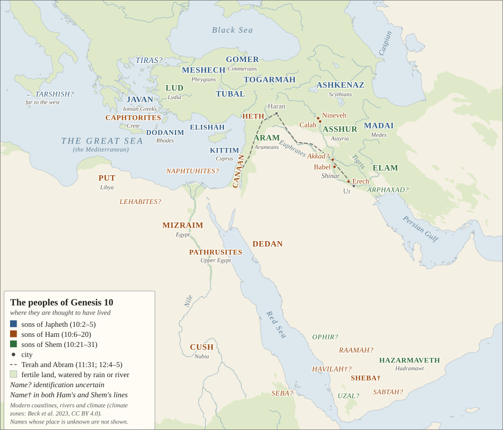
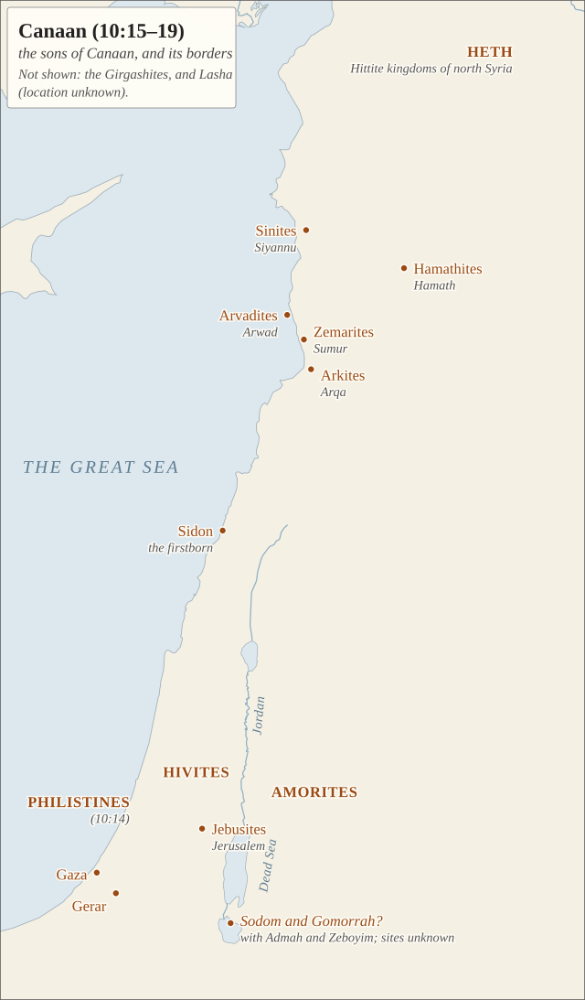

# The table of nations

A source sheet for **[Session 11](../)**: Genesis 10 in full, the map, a
detail map of Canaan, and every name in the chapter with what scholars think
it refers to, how sure they are, and what Josephus thought in the first
century.

---

## The map

<figure class="map-figure">

<figcaption>The peoples of Genesis 10, placed where they are thought to have lived; colour shows which of Noah's sons the list traces them to. Names marked ? are uncertain; Sheba and Havilah (†) appear in both Ham's line (10:7) and Shem's (10:28–29). The dashed line is Terah and Abram's road from Ur to Haran and on to Canaan (11:31; 12:4–5). Coastlines and rivers are modern, from Natural Earth (public domain). Drawn for this study.</figcaption>
</figure>

**What the map shows.** The names were not thrown together at random; they
are the world as it looked from Israel in the first half of the first
millennium BC. The peoples on the list are attested side by side in the
records of the ninth to sixth centuries BC — the Cimmerians and Scythians on
Assyria's northern frontier, the Medes, the Ionian Greeks, the Anatolian
kingdoms of Tabal and the Mushki, Kush on the Nile, Saba in Yemen. The
horizon runs from Tarshish in the far west (probably Tartessos in Spain) to
Media and Elam in the east, and from the Black Sea to Nubia and the south of
Arabia. Japheth's sons lie broadly to the north and west, Ham's to the south
and south-west (with Canaan and Nimrod's Mesopotamia), Shem's to the east and
south-east. The three meet around Canaan and Syria.

**What the map does not show.** Nineteen names have no known location and are
left off: Magog, Riphath, Sabteca, the Ludites, Anamites and Casluhites, the
Girgashites, Uz, Hul, Gether, Mash, and eight of Joktan's thirteen sons
(Almodad, Sheleph, Jerah, Hadoram, Diklah, Obal, Abimael, Jobab). Four
individuals — Nimrod, Shelah, Eber and Peleg — are people, not peoples.

<figure class="map-figure" id="canaan">

<figcaption>Canaan's sons and borders (10:15–19). The northern names — Arwad, Sumur, Arqa, Siyannu, Hamath — are cities on the Phoenician and Syrian coast and the Orontes. The southern border runs from Sidon to Gerar and Gaza, and to the cities of the plain, whose sites are not known.</figcaption>
</figure>

---

## Genesis 10

> **1** This is the account of Noah's sons: Shem, Ham, and Japheth. Sons were
> born to them after the flood.
>
> **2** The sons of Japheth were Gomer, Magog, Madai, Javan, Tubal, Meshech,
> and Tiras. **3** The sons of Gomer were Ashkenaz, Riphath, and Togarmah.
> **4** The sons of Javan were Elishah, Tarshish, the Kittim, and the
> Dodanim. **5** From these the coastlands of the nations were separated into
> their lands, every one according to its language, according to their
> families, by their nations.
>
> **6** The sons of Ham were Cush, Mizraim, Put, and Canaan. **7** The sons of
> Cush were Seba, Havilah, Sabtah, Raamah, and Sabteca. The sons of Raamah
> were Sheba and Dedan. **8** Cush was the father of Nimrod; he began to be a
> valiant warrior on the earth. **9** He was a mighty hunter before the LORD.
> (That is why it is said, "Like Nimrod, a mighty hunter before the LORD.")
> **10** The primary regions of his kingdom were Babel, Erech, Akkad, and
> Calneh in the land of Shinar. **11** From that land he went to Assyria,
> where he built Nineveh, Rehoboth Ir, Calah, **12** and Resen, which is
> between Nineveh and the great city Calah. **13** Mizraim was the father of
> the Ludites, Anamites, Lehabites, Naphtuhites, **14** Pathrusites,
> Casluhites (from whom the Philistines came), and Caphtorites. **15** Canaan
> was the father of Sidon his firstborn, Heth, **16** the Jebusites, Amorites,
> Girgashites, **17** Hivites, Arkites, Sinites, **18** Arvadites, Zemarites,
> and Hamathites. Eventually the families of the Canaanites were scattered
> **19** and the borders of Canaan extended from Sidon all the way to Gerar as
> far as Gaza, and all the way to Sodom, Gomorrah, Admah, and Zeboyim, as far
> as Lasha. **20** These are the sons of Ham, according to their families,
> according to their languages, by their lands, and by their nations.
>
> **21** And sons were also born to Shem (the older brother of Japheth), the
> father of all the sons of Eber. **22** The sons of Shem were Elam, Asshur,
> Arphaxad, Lud, and Aram. **23** The sons of Aram were Uz, Hul, Gether, and
> Mash. **24** Arphaxad was the father of Shelah, and Shelah was the father of
> Eber. **25** Two sons were born to Eber: One was named Peleg because in his
> days the earth was divided, and his brother's name was Joktan. **26** Joktan
> was the father of Almodad, Sheleph, Hazarmaveth, Jerah, **27** Hadoram,
> Uzal, Diklah, **28** Obal, Abimael, Sheba, **29** Ophir, Havilah, and Jobab.
> All these were sons of Joktan. **30** Their dwelling place was from Mesha all
> the way to Sephar in the eastern hills. **31** These are the sons of Shem
> according to their families, according to their languages, by their lands,
> and according to their nations.
>
> **32** These are the families of the sons of Noah, according to their
> genealogies, by their nations, and from these the nations spread over the
> earth after the flood.

---

## Every name

**How sure:** *secure* — scholars agree; *probable* — the usual view, with
some doubt; *uncertain* — several candidates (the map shows the one most often
favoured, marked ?); *unknown* — no plausible location. The last column is
Josephus, *Antiquities* 1.6 (c. 94 CE), the oldest surviving attempt to place
every name; where he differs from the modern view, his is often the
geography of his own day.

### The sons of Japheth (10:2–5)

| Name | Who they were | How sure | Josephus |
|---|---|---|---|
| Gomer | the Cimmerians, horsemen from the steppe who raided Anatolia in the 8th–7th centuries BC (Assyrian *Gimirrāya*) | secure | the Galatians of central Anatolia |
| Magog | an unidentified people of the far north (in Ezekiel 38–39, the land of Gog) | uncertain | the Scythians |
| Madai | the Medes, of north-west Iran | secure | the Medes |
| Javan | the Ionians, then Greeks in general (the name is "Ionia") | secure | Ionia and all the Greeks |
| Tubal | Tabal, a kingdom of south-central Anatolia (Assyrian records) | secure | the Iberians of the Caucasus (Georgia) |
| Meshech | the Mushki — by the 8th century BC, the Assyrian name for the Phrygians | secure | the Cappadocians |
| Tiras | unidentified; most often the Tyrrhenians, a sea people, or the Thracians | uncertain | the Thracians |
| Ashkenaz | the Scythians (Assyrian *Aškuzāya*) | probable | "Rheginians" |
| Riphath | unidentified | unknown | the Paphlagonians |
| Togarmah | Tegarama, a town and district of eastern Anatolia | probable | the Phrygians |
| Elishah | Alashiya — Cyprus, or part of it | probable | the Aeolians |
| Tarshish | a far-western source of metals, most often Tartessos in Spain | uncertain | Tarsus in Cilicia |
| the Kittim | Kition, on Cyprus; then Cypriots, and later westerners in general | secure | Cyprus |
| the Dodanim | Rhodians — reading *Rodanim*, with 1 Chronicles 1:7 and the Greek | probable | — |

### The sons of Ham (10:6–20)

| Name | Who they were | How sure | Josephus |
|---|---|---|---|
| Cush | Kush — Nubia, the Nile valley south of Egypt | secure | the Ethiopians |
| Mizraim | Egypt | secure | Egypt |
| Put | Libya, west of Egypt | probable | Libya |
| Canaan | Canaan: the southern Levant and the Phoenician coast | secure | Judea |
| Seba | probably Sabaean settlements in Eritrea and northern Ethiopia | uncertain | the Sabeans |
| Havilah† | a region of Arabia, most often Ḫawlān in north-west Yemen | uncertain | the Getuli of north-west Africa |
| Sabtah | probably Shabwa, capital of Hadramawt | uncertain | the Astaborans of Nubia |
| Raamah | probably Ragmat, the ancient name of the Najran oasis | uncertain | — |
| Sabteca | unidentified | unknown | — |
| Sheba† | Saba, the Sabaean kingdom of Yemen (the queen of Sheba's) | secure | the Sabeans |
| Dedan | the oasis of al-ʿUla in north-west Arabia | secure | western Ethiopians |
| *Nimrod* | a person; no agreed historical figure (see below) | — | the tyrant of Babylon who drove the building of the tower |
| *Babel, Erech, Akkad* | Babylon; Uruk; Akkad (Sargon's capital, its ruins not yet found) | secure | — |
| *Calneh* | perhaps not a city: read *wəkullānâ*, "all of them" (in the land of Shinar) | uncertain | — |
| *Shinar* | Babylonia | secure | — |
| *Nineveh, Calah* | Nineveh (opposite Mosul); Kalḫu, now Nimrud | secure | — |
| *Rehoboth Ir, Resen* | probably "the broad places of the city" (Nineveh's squares); Resen unidentified | uncertain | — |
| Ludites | unidentified: Lydian mercenaries in Egypt, or Libyans | uncertain | names only |
| Anamites | unidentified | unknown | names only |
| Lehabites | probably Libyans | uncertain | Libya |
| Naphtuhites | perhaps Lower Egypt, the Delta | uncertain | names only |
| Pathrusites | Pathros, Upper Egypt ("the Southland") | secure | names only |
| Casluhites | unidentified | unknown | names only |
| *Philistines* | the Philistines of the southern coast | secure | the Philistim, from Gaza toward Egypt |
| Caphtorites | Caphtor — Crete | probable | names only |
| Sidon | Sidon, the leading Phoenician city | secure | Sidon |
| Heth | the Hittites — most likely the "Hittite" kingdoms of north Syria in Assyrian records | probable | names only |
| Jebusites | the people of Jerusalem before David | secure | names only |
| Amorites | in the Old Testament, a general name for the hill peoples of Canaan and beyond the Jordan | secure | names only |
| Girgashites | unidentified | unknown | names only |
| Hivites | a people known only from the Bible: at Shechem, at Gibeon, and "under Hermon" | probable | names only |
| Arkites | Arqa, in north Lebanon | secure | Arce, in Lebanon |
| Sinites | Siyannu, on the Syrian coast | probable | names only |
| Arvadites | Arwad, the island city off Syria | secure | the island Aradus |
| Zemarites | Sumur, on the Syrian coast | probable | names only |
| Hamathites | Hamath (Hama) on the Orontes | secure | Hamath, later Epiphania |
| *Gerar, Gaza* | Tel Haror in the Negev; Gaza | probable; secure | — |
| *Sodom, Gomorrah, Admah, Zeboyim* | the cities of the plain by the Dead Sea; sites not identified | uncertain | — |
| *Lasha* | unidentified | unknown | — |

### The sons of Shem (10:21–31)

| Name | Who they were | How sure | Josephus |
|---|---|---|---|
| Elam | Elam, in south-west Iran (capital Susa) | secure | the Elamites, ancestors of the Persians |
| Asshur | Assyria, on the upper Tigris | secure | the Assyrians, at Nineveh |
| Arphaxad | an unexplained name, most often linked with the Chaldeans of southern Babylonia | uncertain | the Chaldeans |
| Lud | Lydia, in western Anatolia | probable | the Lydians |
| Aram | the Arameans of Syria and upper Mesopotamia | secure | the Syrians |
| Uz | Job's land: in Aramean Syria, or in Edom and north Arabia | uncertain | Trachonitis and Damascus |
| Hul, Gether, Mash | unidentified | unknown | Armenia; Bactria; Charax Spasini |
| *Shelah, Eber, Peleg* | links in the line to Abram; *Eber* is the ancestor of the "Hebrews"; *Peleg* means "division" | — | Heber, from whom the Hebrews are named |
| *Joktan* | ancestor of thirteen peoples of south and west Arabia | — | — |
| Almodad | unidentified South Arabian group | unknown | — |
| Sheleph | a Yemeni tribe or district (as-Salif) | uncertain | — |
| Hazarmaveth | Hadramawt, the incense kingdom of southern Arabia | secure | — |
| Jerah, Hadoram | unidentified | unknown | — |
| Uzal | probably Azal, by Arab tradition the old name of Sanaa | uncertain | — |
| Diklah, Obal, Abimael | unidentified | unknown | — |
| Sheba† | Saba (as in 10:7) | secure | placed with Joktan's sons by the Indus |
| Ophir | the land of fine gold reached by Red Sea ships, most often placed in south-west Arabia | uncertain | in India |
| Havilah† | as in 10:7 | uncertain | — |
| Jobab | unidentified | unknown | — |
| *Mesha, Sephar* | the limits of Joktan's land; Sephar probably a Ẓafār in South Arabia | uncertain | — |

(Names in *italics* are individuals or places, not peoples.)

---

## Notes

### Seventy

Count the peoples — not Noah's sons, not Nimrod (one man), not the places —
and the Hebrew list comes to **seventy**: fourteen for Japheth, thirty for Ham
(counting the Philistines), twenty-six for Shem (counting Shelah, Eber and
Peleg). Gordon Wenham: *"It seems likely that the total number of nations…
comes to seventy"* (*Genesis 1–15*, 1987). Counting Nimrod and leaving out the
Philistines also gives seventy. The Greek translation has two more names —
Elisa as a son of Japheth and Kainan between Arphaxad and Shelah — and so
**seventy-two**, though its manuscripts differ. Jewish tradition took seventy
as the number of the nations and their languages; the sources are on
**[Babel among its readers](early-readers.html)**, §4.

### Sorted by place, not by language

The table does not sort peoples by the language they spoke, as we would.
Canaanites spoke a language so close to Hebrew that Isaiah calls Hebrew *"the
language of Canaan"* (19:18), yet Canaan stands with Egypt among the sons of
Ham. Elam's language was related to none of its neighbours', and Lydian to
none of the Semitic languages, yet both stand with Shem. The grouping follows
geography and political history — who lived near whom, and who belonged to
whose sphere. (Our word "Semitic" was coined from this chapter, in 1781, and
it means something the chapter does not.)

### The same names twice

**Sheba** and **Havilah** appear as sons of Cush (10:7) and as sons of Joktan
(10:28–29); Sheba and Dedan come back again as grandsons of Abraham by Keturah
(25:3). Readers explain it three ways: two lists joined (the source-critical
view assigns 10:7 to the priestly strand and 10:26–29 to the other); peoples
of the Red Sea trade who lived on both its shores; or a genealogy of trading
and political ties rather than of blood.

**Assyria** appears twice too: Nimrod *"went to Assyria"* (10:11), yet Asshur
is a son of Shem (10:22). The Hebrew of 10:11 can also be read *"from that
land Asshur went out."*

### Who is missing

**Israel**, for one: its ancestor stands in the list only as Eber. Missing
too are Tyre, Persia, Urartu (Ararat), and Israel's nearest neighbours —
Edom, Moab, Ammon and the Ishmaelites. Genesis gives those later, as they
come into Abraham's family story.

### Nimrod

No one knows who Nimrod was. Candidates proposed over the last century
include the war-and-hunting god Ninurta, the Assyrian king Tukulti-Ninurta I,
and Sargon of Akkad; none has won agreement. Genesis gives him two verses and
four cities. Whether his father **Cush** (10:8) is the Nubian Cush of 10:6 or
a Mesopotamian name (the Kassites, *Kaššû*, who ruled Babylon for four
centuries; or the city of Kish) is debated. Josephus and the rabbis made him
the tower-builder; the Aramaic paraphrase *Pseudo-Jonathan* says the opposite,
that he left Babylon for Assyria *"because he would not be in the counsel of a
divided generation."*

### Other maps

No openly licensed map of Genesis 10 that is both modern and complete could be
found, which is why this one was drawn. Wikimedia Commons has a modern map of
Ham's and Shem's lines only, after the *Macmillan Bible Atlas* (CC BY-SA 4.0),
a map of Josephus's identifications (CC BY-SA 3.0), and two public-domain maps
from 1854 and 1905 whose identifications are now out of date. The coordinates
of OpenBible.info's Bible geocoding data (CC BY 4.0) agree with this map's
placements almost everywhere.

---

## Sources

- **Scripture** quoted by permission from the NET Bible® copyright ©1996,
  2019 by Biblical Studies Press, L.L.C., [netbible.com](https://netbible.com).
  All rights reserved.
- **The maps** were drawn for this study. Coastlines, lakes and rivers:
  [Natural Earth](https://www.naturalearthdata.com/), public domain. Site
  coordinates checked against [OpenBible.info's Bible geocoding
  data](https://github.com/openbibleinfo/Bible-Geocoding-Data) (CC BY 4.0).
- **Identifications** follow, chiefly: G. J. Wenham, *Genesis 1–15* (WBC,
  1987); N. Sarna, *The JPS Torah Commentary: Genesis* (1989); C. Westermann,
  *Genesis 1–11* (Eng. 1984); J. Day, "The Table of Nations: The Geography of
  the World in Genesis 10," TheTorah.com (2022), and *From Creation to
  Abraham* (2021); R. Hendel, *Genesis 1–11* (Anchor Yale Bible, 2024); E. M.
  Yamauchi, *Foes from the Northern Frontier* (1982); the *Anchor Bible
  Dictionary* (1992). Described, not quoted, except Wenham's sentence on the
  seventy.
- **Josephus**, *Antiquities* 1.6.1–4, trans. W. Whiston (1737), public
  domain.

Retrieved and checked 2026-10-23.

[← Back to Session 11](../)
{: .no-print}
