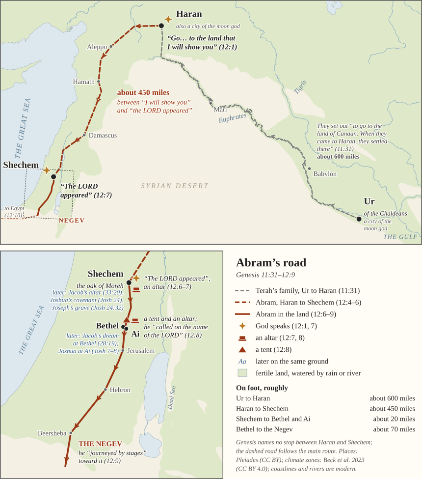

# Abram's road on the ground

A source sheet for **[Session 12](../)**: the places on the handout's map, how
they are identified, and what is known — and not known — about the road
between them.

<figure class="map-figure">

</figure>

**What Genesis names, and what it doesn't.** Genesis gives Ur and Haran
(11:31), then *"the land of Canaan"* (12:5), Shechem and the oak of Moreh
(12:6), the hill country between Bethel and Ai (12:8), the Negev (12:9), and
Egypt (12:10). Every point between Haran and Shechem is reconstruction, which
is why the map draws that stretch dashed.

---

## The places

| On the map | Identified with | How sure | Coordinates (Pleiades) |
|---|---|---|---|
| **Ur** of the Chaldeans | Tell el-Muqayyar, southern Iraq | most scholars; a minority looks north (below) | 30.961 N, 46.105 E |
| **Haran** | Harran (Altınbaşak), southern Turkey, about 40 km south-east of Urfa | secure — the name never changed | 36.864 N, 39.031 E |
| **Shechem** | Tell Balata, at the east end of Nablus | secure | 32.214 N, 35.282 E |
| oak of **Moreh** | somewhere at Shechem | the tree's spot is unknown | — |
| **Bethel** | Beitin | nearly all scholars (a minority: el-Bireh) | 31.928 N, 35.238 E |
| **Ai** | et-Tell, 2.5 km east-south-east of Beitin | most scholars (a minority: Khirbet el-Maqatir, 1 km west) | 31.917 N, 35.262 E |
| **the Negev** | the dry south, around Beersheba | a region, not a point | — |
| Babylon, Mari, Aleppo, Hamath, Damascus, Jerusalem, Hebron, Beersheba | for orientation only — Genesis does not put Abram in any of them in this passage | secure | Pleiades 893951, 286681704, 658409, 668182, 678106, 687928, 687915, 687846 |
{: .ff-wrap}

---

## 1. Ur of the Chaldeans

**The site.** In 1853–54 J. E. Taylor dug at Tell el-Muqayyar ("the mound of
bitumen") in southern Iraq and found clay cylinders of Nabonidus, the last king
of Babylon. In 1862 Henry Rawlinson read the city's name on them — Ur — and it
was linked at once with the *Ur Kasdim* of Genesis. Sir Leonard Woolley dug
there for twelve seasons, 1922–1934, for the British Museum and the University
of Pennsylvania, and made Abraham's name part of the site's in his popular
book *Ur of the Chaldees* (1929).

**"Of the Chaldeans."** The Chaldeans (*Kasdîm* in Hebrew, *Kaldu* in
Assyrian) were tribes in the marshy far south of Babylonia, first named in
Assyrian records of the 9th century BC; by the 6th century a Chaldean dynasty
ruled Babylon, Nebuchadnezzar's. So the label is later than any date usually
given for Abram. Readers take that two ways. Most scholars read it as the
narrator naming the place for readers of his own day, the way Genesis 14:14
says Abram pursued the kings *"as far as Dan,"* a city named centuries later.
Conservative reference works make the same point from the other side: a place
is called by the name its readers know, so a later name says nothing about the
age of the story.

**A northern Ur?** A long minority tradition puts Abram's birthplace near
Haran. At Urfa (ancient Edessa), forty kilometres from Haran, the pool of sacred
fish called Balıklıgöl is pointed out as the place where Nimrod's fire turned
to water; a traveller in 1743 reported that *"the Jews universally are of
opinion, that it is Ur of the Chaldees."* The scholar Cyrus Gordon, who had dug
with Woolley, argued in 1958 and 1977 for a northern trading town called Ura.
A bishop of Haran in the 4th century told the pilgrim Egeria that Ur lay ten
stages east, beyond Nisibis. The strongest biblical argument for the north is
that Abraham later calls the Haran district *"my country… my relatives"*
(24:4). Against it: the only known Ur in Chaldean territory is the southern
one; the Greek translation of Genesis reads *"the land of the Chaldeans,"*
that is, Babylonia (11:28, 31; 15:7), and Stephen follows it (*"the country of
the Chaldeans,"* Acts 7:4); and other early writers — Pseudo-Eupolemus in the
2nd century BC, Nicolaus of Damascus, Josephus — put Ur in Babylonia. The
handout and map follow the majority.

---

## 2. Two cities of the moon god

**Ur** was the city of the moon god — Nanna in Sumerian, Sin in Akkadian. His
temple was the Ekishnugal, "house of the great light," and his ziggurat, built
under Ur-Nammu around 2100 BC and rebuilt by Nabonidus, still stands.

**Haran** was the moon god's other great home. Its name is the Akkadian word
*ḫarrānu*, "road, journey, caravan": it stood where the trade routes crossed. The Mari letters of the 18th
century BC already mention Sin of Haran; north Syrian inscriptions call him
*Bēl-Ḫarrān*, "Lord of Haran"; and his temple, E-ḫulḫul, "house of joy," was
rebuilt by Nabonidus, whose mother Adad-guppi served Sin there. Her funerary
inscription, found in the pavement of Haran's great mosque in 1956, tells how
the god promised her in a dream that her son would restore it.

So Terah's family moved from one city of the moon god to the other. Genesis
does not name their gods; Joshua says only *"They worshiped other gods"*
(Joshua 24:2). Linking those gods to the moon is an inference, though a
common one.

**The family's names.** Late-19th- and early-20th-century scholars noticed
that *Sarai* ("princess") and *Milcah* ("queen") match titles of goddesses
worshipped at Haran, Akkadian *šarratu* for the moon god's consort and
*malkatu* for Ishtar, and some tried to read *Terah* as a form of *yārēaḥ*,
"moon." John Skinner, writing in 1910, thought the coincidence real but added
that *"these associations, if they existed, are forgotten in the Hebrew
legend."* This remains speculation. Better attested: several of Abram's
ancestors share their names with towns of the Haran district in Assyrian
records — Serug with Sarugi, Nahor with Nakhur (also in the Mari letters),
Terah with Til-Turahi on the Balikh.

---

## 3. The road from Ur to Haran

The usual reconstruction follows the Euphrates north-west past Babylon and
Mari to the mouth of the Balikh river at Tuttul, then up the Balikh to Haran:
about 1,000 kilometres, some 600 miles, along those waypoints, and more on the
ground.

There is a real itinerary from Abram's era. A clay tablet published by
Albrecht Goetze in 1953 records a round trip in the 19th or 18th century BC
from Larsa — some 45 kilometres from Ur — north by way of the Tigris and the
northern plain, past *"Apqum of the Balikh,"* the river's source pool, to
Haran, and home again by the Euphrates. Its last line: *"[a tota]l of 6 months
(and) 14 days elapsed till my return."* That is a working traveller's pace —
and Terah's party, with flocks and a household, would have moved slower.

---

## 4. Haran to Shechem: the road not named

From Haran the usual reconstruction crosses the Euphrates at Carchemish ("the
great ford," about 90 km west), then follows the corridor west of the desert:
Aleppo, Ebla, Hamath, Qatna, Damascus. From Damascus there are two ways into
the hill country:

- **West of the Jordan**, past Hazor, down to Beth-shean, and up past Tirzah to
  Shechem — the line on the map.
- **East of the Jordan**, through Bashan and Gilead, across the river at the
  Adam ford, and up the Wadi Far'ah to Shechem. This is Jacob's road coming
  home from Haran: he *"headed for the hill country of Gilead"* (31:21), passed
  Penuel and Succoth (32:30; 33:17), and *"came safely to the city of Shechem"*
  (33:18).

Either way the walk is roughly 700 kilometres, 425–450 miles. Two scraps tie
Damascus to Abram: his steward is *"Eliezer of Damascus"* (15:2), and the
Greek historian Nicolaus of Damascus, quoted by Josephus, says *"Abram reigned
at Damascus"* and that a village there was called *"The Habitation of Abram"*
(*Antiquities* 1.7.2) — a local legend, but an old one.

---

## 5. Shechem and the oak of Moreh

**The site.** Tell Balata lies at the east end of the pass between Mount
Gerizim (south) and Mount Ebal (north), where the north–south road along the
hill country meets the road down to the Jordan. Ernst Sellin dug there in
1913–14 and 1926–34; the Drew–McCormick expedition under G. Ernest Wright dug
from 1956 into the late 1960s; a Palestinian–Dutch team made it an
archaeological park in 2010–14.

**In Abram's age** Shechem was a real city. An Egyptian stela of the 19th
century BC already records a campaign in which *"Sekmem fell."* By about
1650–1550 BC it had massive walls, two gates and a great "fortress-temple"
with walls five metres thick. In the 14th century its king, Lab'ayu, ruled
much of the hill country and appears in the Amarna letters, protesting to
Pharaoh that he is no rebel (EA 252–254) while the king of Jerusalem accuses
him (EA 289).

**The oak.** *Moreh* is a participle of the verb *yārâ*, "point out, direct,
teach" — "teacher." Many commentators (Claus Westermann, Nahum Sarna, the UBS
translators' handbook) take *"the oak of Moreh"* to mean "the oracle-giver's
tree": a great tree where people sought divine answers, a kind of sanctuary
"not made with hands." Shechem had several such trees in its story — the oak
where Jacob buried his household's idols (35:4), *"the oaks of Moreh"* beside
Gerizim and Ebal (Deuteronomy 11:30), the oak by the sanctuary where Joshua set
up his stone (Joshua 24:26), the oak where Abimelech was made king (Judges
9:6), and *"the Oak Tree of the Diviners"* (Judges 9:37). Jewish commentators
read the name differently: for Rashi, Moreh is where God *"showed him Mount
Gerizim and Mount Ebal"*; for Ramban, Moreh was the name of a Canaanite who
owned the place. The tree's exact spot is unknown.

---

## 6. Bethel and Ai

**Bethel** is Beitin, ten miles north of Jerusalem, identified by Edward
Robinson in 1838 from the surviving name and an ancient road-distance, and dug
by W. F. Albright and J. L. Kelso between 1927 and 1960. A minority (David
Livingston, John Bimson) has argued for el-Bireh, three kilometres away;
Anson Rainey's reply, *"Bethel Is Still Beitîn"* (1971), carried most
scholars.

**Ai** means "the ruin" (*hā-ʿay*), and is usually placed at et-Tell, whose
Arabic name means the same. Excavation found a large walled city of the Early
Bronze Age, destroyed about 2400 BC and then empty for more than a thousand
years, until a small village of about 1220–1050 BC. So when Abram camped
*"with Bethel on the west and Ai on the east,"* et-Tell was already an old
ruin — a landmark with a fitting name. Its long gap creates a well-known
difficulty for the story of Joshua's battle there (Joshua 7–8), since no city
stood at et-Tell in the centuries usually given for the conquest. Proposed
answers include: the Joshua story explains an old ruin (Martin Noth); the
capture of nearby Bethel was told as the capture of Ai (Albright); or Joshua's
Ai lies elsewhere. The Associates for Biblical Research, under Bryant Wood and
then Scott Stripling, dug Khirbet el-Maqatir, one kilometre west of et-Tell,
from 1995 to 2016, and report a small fortress burned in the late 15th century
BC, which they identify with Joshua's Ai; most scholars still place Ai at
et-Tell. For Genesis 12:8 either way, Ai is a landmark east of Abram's tent.

---

## 7. The Negev

*Negev* comes from a root meaning "dry," and it is the ordinary Hebrew word
for "south." In Genesis it is the dry pastoral country around Beersheba, Gerar
and Kadesh (13:1; 20:1), beginning south of the Hebron hills. *"By stages down
to the Negev"* (12:9) means southward along the ridge road, through or past
the places the map shows only for orientation: Shiloh, Jerusalem, Bethlehem,
Hebron. Genesis names none of them here.

---

## 8. The same ground, later

| Place | Later in the story |
|---|---|
| **Shechem** | Jacob buys land and sets up an altar, *"The God of Israel is God"* (33:18–20); Dinah (34); Jacob buries his household's idols under the oak (35:4); Joseph looks for his brothers there (37:12–14); Joshua's covenant and stone under the oak (Joshua 24:1, 25–26); Joseph's bones buried in Jacob's field (Joshua 24:32); Abimelech made king by the oak (Judges 9:6); the kingdom divides there (1 Kings 12:1), and Jeroboam makes it his first capital (12:25) |
| **Gerizim and Ebal** | the blessing and the curse (Deuteronomy 11:29; 27); Joshua's altar on Ebal (Joshua 8:30–35) |
| **Bethel** | Jacob's dream (28:19); his return and altar, *El-Bethel* (35:6–7); Jeroboam's golden calf (1 Kings 12:28–29) |
| **Ai** | Achan's sin and the defeat; the city taken and made *"a permanently uninhabited mound"* (Joshua 7–8) |
| **between Bethel and Ai** | Abram comes back *"to the place where he had pitched his tent at the beginning"* (13:3–4) |
{: .ff-wrap}

Jacob's two altars stand at Abram's two: Shechem and Bethel. Ramban's rule for
reading the patriarchs, *"Whatever has happened to the patriarchs is a sign to
the children,"* and Rashi's picture of Abram praying at Shechem and Ai for the
descendants who would struggle there, are on **[the readers'
sheet](early-readers.html)**.

---

## 9. Distances

Measured along the waypoints named above (great-circle, leg by leg); real
walking distance would be longer.

| Leg | Straight line | Along the road |
|---|---|---|
| Ur to Haran | 925 km / 575 mi | about 1,000 km / 620 mi |
| Haran to Shechem | 620 km / 386 mi | about 685–725 km / 425–450 mi |
| Shechem to Bethel and Ai | 32 km / 20 mi | 33 km / 20 mi, by Shiloh |
| Bethel to Beersheba | 85 km / 53 mi | 87 km / 54 mi, by Jerusalem and Hebron |
| Ur to Beersheba | — | about 1,820 km / 1,130 mi |
{: .ff-wrap}

---

## How the map was made

The map was drawn for this study with the same tools as the Session 11 maps
(`tools/table-of-nations-map/abram.py` in the project). Coastlines, lakes and
rivers are Natural Earth (public domain), and modern; the Euphrates in
particular ran farther east in Abram's day, past Ur and Uruk. Green marks land
that is not desert in today's climate (H. E. Beck and others, Köppen–Geiger
climate maps, 2023, CC BY 4.0), plus the river valleys. Place coordinates are
from Pleiades, the gazetteer of ancient places (CC BY). Distances are rounded
to the nearest 50 miles on the map.

---

*Scripture quoted by permission from the NET Bible® copyright ©1996, 2019 by Biblical Studies Press, L.L.C., [netbible.com](https://netbible.com). All rights reserved. Coordinates from Pleiades: A Gazetteer of Past Places (pleiades.stoa.org), CC BY. Josephus from W. Whiston (1737), public domain. Rashi from M. Rosenbaum and A. M. Silbermann (public domain, as labelled by Sefaria); Ramban from C. B. Chavel (CC BY), via Sefaria. J. Skinner, A Critical and Exegetical Commentary on Genesis (1910), public domain. The pilgrim Egeria from M. L. McClure and C. L. Feltoe (1919), public domain. A. Goetze, "An Old Babylonian Itinerary," Journal of Cuneiform Studies 7 (1953). Described, not quoted: D. Charpin, lecture on the excavation history of Ur (Collège de France, 2018); C. H. Gordon, "Abraham and the Merchants of Ura," Journal of Near Eastern Studies 17 (1958), and "Where Is Abraham's Ur?" Biblical Archaeology Review 3:2 (1977); H. W. F. Saggs, "Ur of the Chaldees," Iraq 22 (1960); C. J. Gadd, "The Harran Inscriptions of Nabonidus," Anatolian Studies 8 (1958); E. F. Campbell, Shechem III (2002); G. E. Wright, Shechem: The Biography of a Biblical City (1965); L. E. Stager, "The Shechem Temple," Biblical Archaeology Review 29:4 (2003); W. L. Moran, The Amarna Letters (1992); C. Westermann, Genesis 12–36 (1985); N. M. Sarna, The JPS Torah Commentary: Genesis (1989); W. D. Reyburn and E. M. Fry, A Handbook on Genesis (1997); J. L. Kelso and W. F. Albright, The Excavation of Bethel (1968); A. F. Rainey, "Bethel Is Still Beitîn," Westminster Theological Journal 33 (1971); J. A. Callaway, "Ai," Anchor Bible Dictionary 1 (1992); the Associates for Biblical Research reports on Khirbet el-Maqatir.*

[← Back to Session 12](../)
